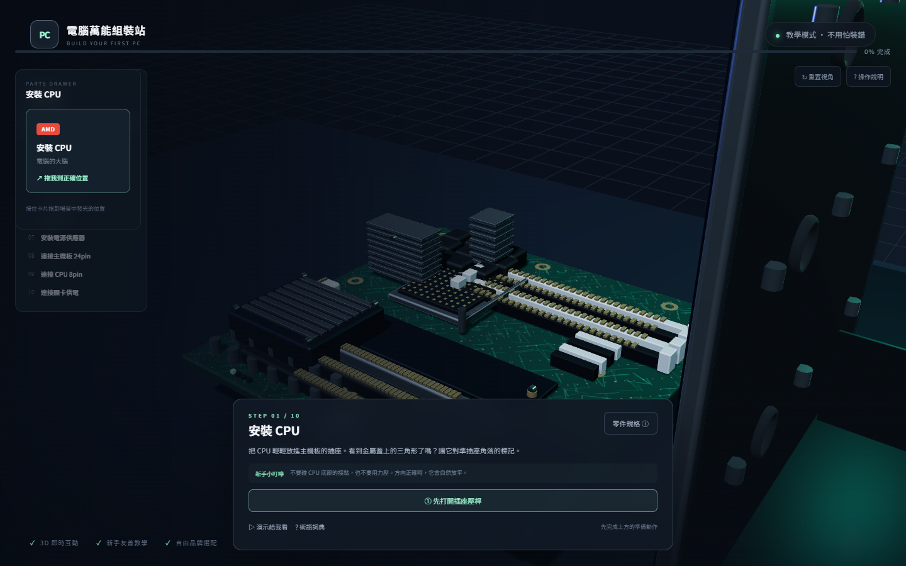

<h1 align="center">電腦萬能組裝站</h1>

<div align="center">
  <h3>
    用 3D 互動的方式，教完全沒接觸過電腦硬體的人，親手組一台電腦。<br />
    拖曳零件、自動吸附、裝錯不會壞，也沒有時間壓力。<br />
  </h3>
</div>

<br />

<p align="center">
  <a href="https://github.com/Faixiang/PC-Building-Studio/issues">
    </a>
  <a href="https://threejs.org">
    </a>
  <a href="https://vitejs.dev">
    </a>
  <a href="https://github.com/Faixiang/PC-Building-Studio">
    </a>
</p>

<br />

<div align="center">
  <figure>
    
    <figcaption>
      <p align="center">
        從零件抽屉取出零件，拖到場景中發光的位置，就會自動吸附對位。
      </p>
    </figcaption>
  </figure>
</div>

## 這是什麼

一個純前端的 3D 裝機教學網站。使用者跟著 10 個步驟走完，就能完成一台電腦。

設計對象是**完全的新手**：所有術語都附白話解釋，每個零件都標示防呆方向，錯誤提示會說明具體做法，而不是責備。

## 功能

組裝流程支援：

- 🧩&nbsp;零件抽屉 — 每步只取出當前零件，從卡片直接拖到插槽。
- 🖱️&nbsp;拖曳自動吸附 — 靠近正確位置顯示半透明預覽，放開自動對位。
- 🎯&nbsp;防呆方向提示 — 缺口、金手指、三角形標記都有視覺引導。
- 🎬&nbsp;演示動畫 — 隨時重播示範，不改變安裝狀態。
- 📊&nbsp;進度條 — 即時顯示完成百分比。

教學內容支援：

- 🏷️&nbsp;品牌選配 — 8 類零件可挑選市面品牌，結果貼在 3D 模型上。
- 📋&nbsp;規格雙模式 — 新手模式與專業模式一鍵切換。
- 💬&nbsp;參數三層說明 — 白話解釋、專業補充、安裝提醒。
- 📖&nbsp;術語詞典 — 看不懂的詞在這裡變簡單。
- ✅&nbsp;完成回顧 — 列出本次安裝的零件與選配清單。

> ⚠️ 規格為教學示例，非特定品牌型號的真實數據。

## 教學流程

1. 安裝 CPU（開壓桿 → 對位放入 → 壓回固定桿）
2. 安裝 CPU 散熱器（含散熱膏提示）
3. 安裝記憶體（A2 插槽）
4. 安裝 M.2 SSD（含固定螺絲）
5. 主機板裝入機殼（銅柱 → 鎖螺絲）
6. 安裝顯示卡
7. 安裝電源供應器
8. 連接主機板 24pin
9. 連接 CPU 8pin
10. 連接顯卡 PCIe 供電

## 3D 模型

9 類半寫實通用模型：機殼、主機板、CPU、散熱器、記憶體、M.2 SSD、顯示卡、電源、供電線材。

細節包含 PCB 走線貼圖、CPU 接點陣列、VRM 散熱鰭片、金手指與防呆缺口、雙面 DRAM 顆粒、風扇與散熱鰭片。

若日後找不到合適的免費素材庫模型，這些程式化模型即為回退方案。

## 快速開始

```bash
npm install
npm run dev      # http://127.0.0.1:5173
npm run build    # 打包到 dist/
```

需求：Node.js 18 以上。

## 技術

- **Three.js** — 3D 渲染、OrbitControls、GLTFLoader
- **Vite** — 開發伺服器與打包
- **原生 JavaScript DOM** — UI 不需要框架
- **Canvas 2D** — 程序化生成 PCB 走線、拉絲金屬、品牌貼花
- **純前端** — 無後端、無資料庫

## 專案結構

```
├─ index.html
├─ vite.config.js
├─ assets/
│  ├─ brands.json      品牌資料庫（8 類零件）
│  ├─ specs.json       規格示例
│  ├─ manifest.json    模型清單與回退對應
│  └─ CREDITS.md       素材授權記錄
└─ src/
   ├─ main.js          組裝流程主控
   ├─ style.css
   ├─ scene/           場景、燈光、相機
   ├─ parts/           程式化模型、載入回退、品牌貼花
   ├─ interaction/     拖曳、吸附、動畫
   ├─ tutorial/        教學步驟、運鏡
   └─ ui/              選配頁、抽屉、面板、規格
```

## 貢獻

- 發現問題或想新增功能？[開 Issue](https://github.com/Faixiang/PC-Building-Studio/issues)。
- 想貢獻程式碼？歡迎送出 Pull Request。

## 素材授權

目前所有 3D 硬體均為本專案以 Three.js 幾何體建立的通用教學模型，未使用外部模型或商標圖檔。

品牌僅以純文字與代表色呈現；品牌名稱與商標權利屬於各自權利人。本專案為硬體教學用途，不表示任何品牌贊助或背書。詳見 [assets/CREDITS.md](assets/CREDITS.md)。

## 後續規劃

- 從 Sketchfab、Poly Haven 等免費素材庫替換為寫實 GLB 模型（CC0 / CC-BY）
- 更多零件類別（一體式水冷、機殼風扇、SATA 硬碟）
- 互動反饋強化（安裝到位的光效）
- 無障礙支援（鍵盤操作、aria 標籤）
